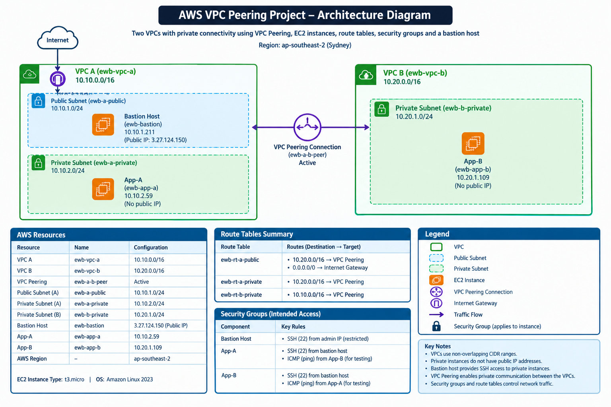

# AWS VPC Peering Project

A hands-on AWS networking project demonstrating private communication between two Virtual Private Clouds (VPCs) using VPC Peering, custom route tables, private EC2 instances, and a bastion host.

## Project Overview

This project explores how two isolated AWS VPCs can communicate privately using a VPC Peering connection. It uses a public bastion host in VPC A to access private EC2 instances and tests network connectivity between instances in both VPCs.

The infrastructure was deployed in the **Asia Pacific (Sydney) — `ap-southeast-2`** AWS Region.

## Architecture

The project uses two custom VPCs connected through an active VPC Peering connection.

> **Note:** The diagram is a logical representation of the lab architecture. It does not represent every security rule or routing detail.

## AWS Resources

| Resource | Name | Configuration |
|---|---|---|
| VPC A | `ewb-vpc-a` | `10.10.0.0/16` |
| VPC B | `ewb-vpc-b` | `10.20.0.0/16` |
| VPC Peering | `ewb-a-b-peer` | Active |
| Public Subnet | `ewb-a-public` | `10.10.1.0/24` |
| Private Subnet A | `ewb-a-private` | `10.10.2.0/24` |
| Private Subnet B | `ewb-b-private` | `10.20.1.0/24` |
| Bastion Host | `ewb-bastion` | Public IP: `3.27.124.150` |
| Private Instance A | `ewb-app-a` | `10.10.2.59` |
| Private Instance B | `ewb-app-b` | `10.20.1.109` |
| AWS Region | — | `ap-southeast-2` |

The EC2 instances use Amazon Linux 2023 and the `t3.micro` instance type.

## Technologies and AWS Services

- **Amazon VPC:** Created isolated virtual networks with separate CIDR ranges.
- **VPC Peering:** Established.
